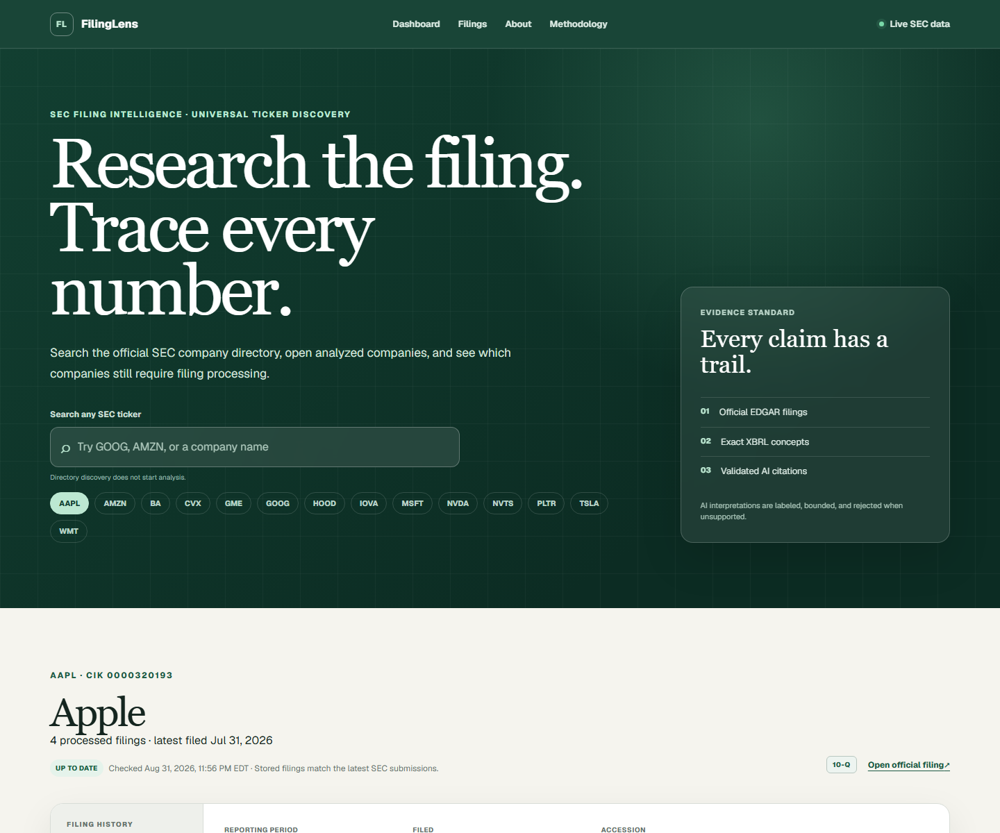
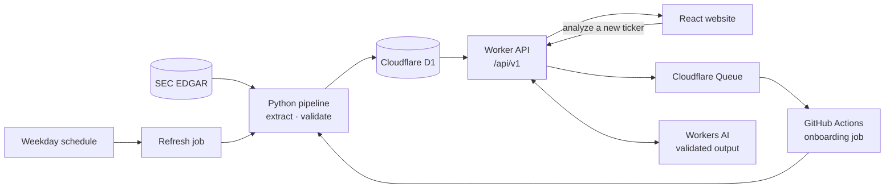

# FilingLens

**Evidence-grounded research on SEC 10-K and 10-Q filings.**

**Live:** <https://filinglens.ritwikkhare.workers.dev>



FilingLens takes a stock ticker and turns the company's official SEC filings into
financial facts, ratios, year-over-year comparisons, risk-factor changes, and an AI
research brief. Every number and AI claim links back to its source in SEC EDGAR, and
anything that can't be traced to a filing isn't shown.

## What it does

- **Search any SEC-registered ticker.** The full SEC company directory (10,000+
  entries) is searchable. Companies that haven't been analyzed yet can be queued for
  analysis from the browser.
- **Financial facts.** Revenue, net income, total assets, total liabilities, and
  operating cash flow come from the filing's XBRL data. Each value records its exact
  US-GAAP concept, period, and SEC link.
- **Ratios.** Net margin, operating cash-flow margin, and liabilities-to-assets are
  calculated in code (not by an AI model). Each one shows its formula and inputs.
- **Year-over-year comparisons.** 10-Ks are compared with the prior year, and 10-Qs
  with the same quarter a year earlier. Periods are matched by SEC fiscal identity, so
  unrelated filings are never compared.
- **Risk-factor changes.** The Item 1A text from consecutive 10-Ks is split into
  passages and labeled added, removed, or materially changed, shown side by side.
- **AI research brief and Q&A.** A Llama 3.3 70B model (Workers AI) writes a summary
  and answers questions using only the stored evidence. Responses are published only
  after every claim passes citation and numeric checks.
- **Daily refresh.** A scheduled GitHub Actions job checks the pilot companies (AAPL,
  MSFT, NVDA, TSLA) for new filings every weekday and imports only filings that
  aren't already stored.

## How it works



1. The **Python pipeline** ([`src/sec_filing`](src/sec_filing)) downloads filings,
   extracts XBRL facts, calculates ratios, matches fiscal periods, and compares risk
   text. A schema validator checks the whole evidence graph before anything is written.
2. **Cloudflare D1** stores companies, filings, facts, ratios, comparisons, risk
   passages, and the evidence links between them.
3. The **Worker API** ([`api/src`](api/src)) serves the data and handles onboarding
   (Turnstile bot check → rate limit → queue → GitHub Actions) and AI requests.
4. The **website** ([`site/`](site)) is a responsive dashboard with Overview, Ratios,
   Comparison, Risks, and AI tabs.

## Design decisions

- **The model never does the math.** The backend calculates every derived value from
  direct SEC facts at full precision. The model must copy the approved display value,
  and the backend independently reproduces each cited number after inference.
- **Fail closed.** If an AI claim cites missing evidence, uses an unsupported number,
  or makes a price forecast, the whole response is rejected. Missing facts stay
  missing, and dependent ratios are skipped instead of estimated.
- **Idempotent imports.** Filings are keyed by immutable SEC accession numbers, so
  retries and repeated refreshes can't duplicate or overwrite data.
- **Bounded cost and abuse.** Turnstile, per-client rate limits, request-size limits,
  and an AI response cache keyed by filing fingerprint, model, and prompt version.

## Tech stack

Python · TypeScript · React · Next.js (Vinext) · Cloudflare Workers, D1, Queues,
Workers AI, and Turnstile · GitHub Actions · Vitest · Python `unittest`

## Run it locally

Requires Python 3.11+, Node.js 22+, and pnpm.

```bash
# Python pipeline: download and analyze a filing (SEC asks for a contact email)
python -m venv .venv && source .venv/bin/activate   # Windows: .venv\Scripts\Activate.ps1
pip install -e .
export SEC_USER_AGENT="Your Name you@example.com"   # Windows: $env:SEC_USER_AGENT = "..."
python -m sec_filing AAPL --build-report             # writes outputs/aapl-sec-intelligence-report.html

# Website (uses the live API by default)
cd site && pnpm install && pnpm dev
```

## Tests

All tests run offline against saved SEC responses and mocked AI providers.

```bash
python -m unittest -v                # 49 Python pipeline tests
cd api && pnpm install && pnpm test  # 72 API / Worker tests
cd site && pnpm install && pnpm test # 21 website tests
```

## Scope and limitations

"Any ticker" means US companies that file standard 10-K and 10-Q reports with
enough history for a prior-year comparison. Foreign issuers (20-F/40-F), funds, and
inactive companies are reported as unsupported rather than forced through the
analysis. Some companies expose fewer facts than others; gaps are shown, not filled.

## More detail

- [Build log](docs/BUILD_LOG.md): the full stage-by-stage development record, API
  routes, deployment notes, and AI validation design
- [Screenshots](docs/screenshots/README.md) (desktop and mobile)
- [Resume bullets](docs/RESUME.md)

Data comes from the SEC's public EDGAR APIs. Requests identify themselves with a
user agent and stay well under the SEC's rate limits.
